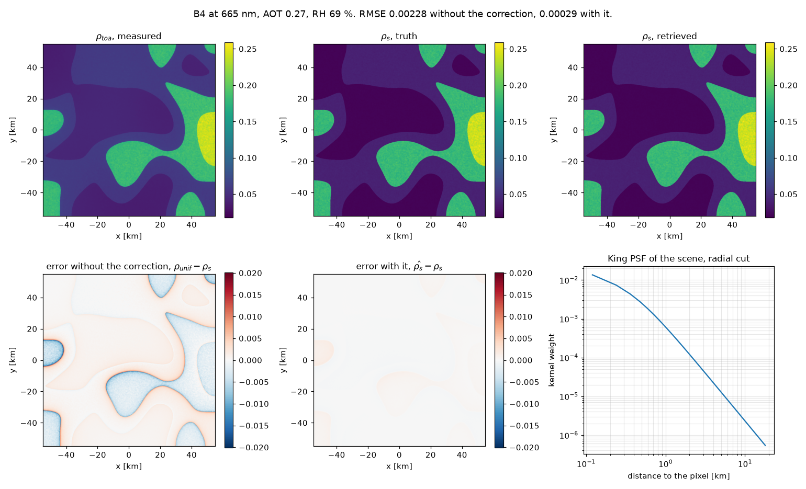

## Environment effects modelling within MAJA next

This repository aims to provide a simple example of the new environment effects correction proposed for MAJA next.

## Installation

There are two environments. The default one runs on the CPU, which is all that is needed to read the code and to correct a tile. The second one runs on the GPU and brings the CUDA build of pytorch instead, and the scripts use it when it is there.

```bash
pixi install            # the default, CPU only
pixi install -e gpu     # the CUDA build, optional
```

## Running it

| Script | What it does |
| -- | -- |
| `scripts/demo.py` | describes `data/scene.nc`, corrects it, prints the error per band |
| `scripts/plot.py` | draws one band and the PSF, into `figures/correction.png` |
| `scripts/check.py` | asserts what the convolution and the kernel must guarantee |

```bash
pixi run python scripts/demo.py             # on the CPU
pixi run -e gpu python scripts/demo.py      # on the GPU
pixi run python scripts/plot.py B8          # another band
```

`demo.py` prints the scene before correcting it, so what is being corrected is on screen:

```
scene     915 x 915 pixels of 120 m, 109.8 km across
bands     B2 (490 nm), B3 (560 nm), B4 (665 nm), B8 (842 nm)
geometry  sza 35°, vza 5°
aot       0.05 to 0.40, mean 0.27
rh        50.00 to 90.00 %, mean 69.04 %
h         0.00 to 1.20 km, mean 0.45 km
aerosol   sulphate 35%, organicm 20%, dust 15%, seasalt 10%, ...
rho_toa   0.017 to 0.369, against 0.009 to 0.387 at the surface

FFT convolution of 915 x 915 by 915 x 915:
  cpu   0.08 s
  cuda  0.03 s

band   RMSE rho_unif  RMSE rho_s    gain
B2           0.00208     0.00042    4.9x
B3           0.00173     0.00030    5.8x
B4           0.00228     0.00029    7.9x
B8           0.00501     0.00048   10.4x
```

The convolution is timed on its own, since it is what the new correction adds over the old one: a kernel the size of the image rather than 15 x 15. Eighty milliseconds per band on a CPU, thirty on a GPU. There is no real interest in using the GPU for a 915 x 915 grid. IT may however become interesting for higher resolutions.

`plot.py` draws one band, B4 by default:



The error map before the correction carries the shape of the land cover: each patch bleeds into its neighbours over kilometres, which is the effect being corrected. After it, what remains is five to ten times smaller and no longer follows the boundaries.

`data/scene.nc` is a synthetic scene whose `rho_toa` was computed forward, from `rho_s` by the 5S formula convolved with the King PSF of its own atmosphere, so the residual `demo.py` prints is the error of the correction rather than a mismatch between two models. The radiative terms are interpolated per pixel from the maps of the product, as MAJA does; only the PSF uses the tile average.


### Comparison of the `old` and `new` environment effect correction

Following is a table comparing both methods:

| | Old | New |
| -- | -- | -- |
| Kernel | Gaussian | King [ref] |
| Parameters | $\sigma$ | $\sigma, \gamma$ |
| Variabilité | No ($\sigma=1 \mathrm{km}$) | Yes, the kernel depends on the aerosol mix, AOT, RH and $\lambda$. |
| Pré-traitement | None | Oui, we must compute $P_\mathrm{5S}(\mathrm{AOT}, \mathrm{RH}, \lambda, \mathrm{Mélange d'aérosol})$ |
| Convolution | Resolution: $240m$ <br> Size: $15\times15$ <br> Padding: miror <br> Method: spatial | Resolution: $120m$ <br> Size: $915\times915$ <br> Padding: miror <br> Method : Linear FFT | 

## Description of the new environment effect correction

### Input parameters

This table describes what the input product carries (see `data/scene.nc` in the codebase):

| Name | Dimensions | Unit | Description |
| -- | -- | -- | -- |
| `rho_toa` | `(band, y, x)` | - | Top-of-atmosphere reflectance |
| `aot` | `(y, x)` | - | Aerosol optical thickness at 550 nm |
| `rh` | `(y, x)` | % | Relative humidity |
| `h` | `(y, x)` | km | Ground elevation |
| `sza`, `vza` | scalar | degree | Solar and viewing zenith angles |
| `wl` | `(band,)` | nm | Band central wavelength |
| `species_fraction` | `(species,)` | - | Fraction of the AOT per aerosol species (CAMS), sums to 1 |
| `valid_mask` | `(y, x)` | - | 1 on the usable pixels, 0 on No_data and edges. Optional |

This table describes what the look-up tables carry (radiative parameters + PSF parameters):

| Name | Dimensions | Unit | Description |
| -- | -- | -- | -- |
| `sigma`, `gamma` | `(band, sza, vza, h, href, rh, aot)`, one file per species | km, - | King PSF parameters (`data/king/<species>.nc`) |
| `tdir`, `tdif` | `(species, band, aot, h, theta)` | - | Direct and diffuse transmittances, read at the solar angle downward and at the viewing angle upward (`data/radiative.nc`) |
| `sph_alb` | `(species, band, aot, h)` | - | Atmospheric spherical albedo |
| `rho_atm` | `(species, band, aot, h, sza, vza)` | - | Atmospheric intrinsic reflectance |

The King tables are the ones deposited on the SEDOO portal. Two of their seven axes hold a single node, since this correction does not make them vary: a solar zenith angle of 40° and a nadir view. The aerosol height scale is set to 2 km, even though it impact the PSF shape, because MAJA has no possibility to infer it from external data. The spectral band is read at its own node rather than interpolated, so what is interpolated is `(aot, rh, h)`.

**Note:** The radiative table is synthetic. It is supposed to represent realistic radiative values, only for the sake of this example.

### Output parameters

This table describes what data the code produce:

| Name | Dimensions | Unit | Description |
| -- | -- | -- | -- |
| `psf_mean` | `(band, n, n)` | - | Mean atmospheric PSF of the scene, $n \times n$ is the image size |
| `rho_unif` | `(band, y, x)` | - | Surface reflectance under the uniform surface assumption |
| `rho_env` | `(band, y, x)` | - | Environment reflectance |
| `rho_s` | `(band, y, x)` | - | Surface reflectance corrected for environment effects |

### Pre-processing

One PSF is computed per band, for the scene-mean atmosphere $(\overline{\mathrm{AOT}}, \overline{\mathrm{RH}}, \lambda)$, on a grid of the image size ($915 \times 915$ at $120m$). The normalised King kernel is:

$$
\hat{K}_{\sigma,\gamma}(r) = \frac{K_{\sigma,\gamma}(r)}{\sum_{\mathrm{grid}} K_{\sigma,\gamma}},
\qquad
K_{\sigma,\gamma}(r) = \left(1 + \frac{r^2}{2\sigma^2\gamma}\right)^{-\gamma}
$$

The kernel is not linear in $(\sigma, \gamma)$, so the parameters are never interpolated: kernels are evaluated at the LUT nodes and interpolated linearly, like the species mixture:

$$
P_\mathrm{mean} = \sum_{s \in \mathrm{species}} f_s \sum_{c \in \mathcal{C}_s} w_c  \hat{K}_{\sigma_s(c), \gamma_s(c)}
$$

where $f_s$ is the AOT fraction of species $s$, $\mathcal{C}_s$ the 8 nodes of the LUT of $s$ surrounding $(\overline{\mathrm{AOT}}, \overline{\mathrm{RH}}, \lambda)$ and $w_c$ their trilinear weights. Kernels are accumulated in place (`psf += weight * kernel`), so the peak memory is three $n \times n$ buffers whatever the number of species. See `mean_king_psf` in `src/maja_environment_effects/psf.py`.

### Atmospheric correction

1. Uniform surface reflectance, inverting the 5S model with $\rho_s = \rho_\mathrm{env}$:

$$
\rho^{\ast} = \rho_\mathrm{toa} - \rho_\mathrm{atm},
\qquad
\rho_\mathrm{unif} = \frac{\rho^{\ast}}{S \rho^{\ast} + T_\mathrm{up} T_\mathrm{down}}
$$

2. Environment reflectance, a linear FFT convolution with mirror padding of $n/2$ pixels on every side:

$$
\rho_\mathrm{env} = \rho_\mathrm{unif} \ast P_\mathrm{mean}
$$

With a `valid_mask` $m$, No_data is left out rather than counted as zero, which matters because the kernel spans the whole tile:

$$
\rho_\mathrm{env} = \frac{(m  \rho_\mathrm{unif}) \ast P_\mathrm{mean}}{m \ast P_\mathrm{mean}}
$$

Both terms are the same convolution, so the FFT applies to both: three forward transforms instead of two, the kernel being transformed once. A pixel whose footprint holds no valid data comes back as No_data.

3. Surface reflectance:

$$
\rho_s = \frac{\rho_\mathrm{unif}  T^\uparrow  F - \rho_\mathrm{env} T_\mathrm{dif}^\uparrow}{T_\mathrm{dir}^\uparrow}
\qquad
F = \frac{1 - s \rho_\mathrm{env}}{1 - s \rho_\mathrm{unif}}
$$

See `correct_scene` in `src/maja_environment_effects/correction.py`.
